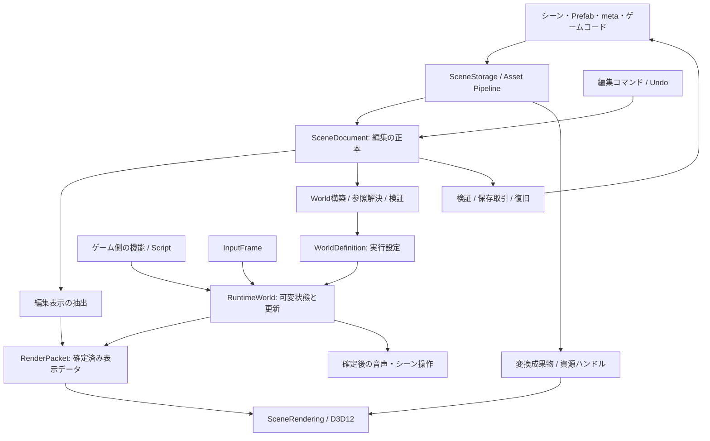
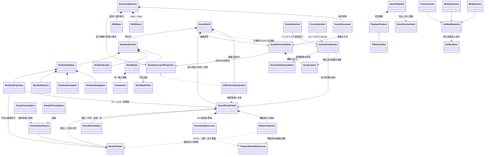

# WP1 エンジン全体設計案

調査日: 2026-10-24（日本時間）

状態: M0〜M7の移行と最終検証が完了。設計時点の調査と移行後の実装を区別する。

実装状況（2026-10-26）: M1の変更捕捉から、CPUドキュメント、WorldDefinition/WorldStateと
RuntimeSession、描画パケット、型別の差分更新、共通アセット成果物、任意のTitleとターゲット分割まで移行した。
公開Script SDKはRuntimeScriptContext/RuntimeScriptDefinitionを使うABI 18へ更新した。
具体的な公開境界は [シーン変更捕捉API](ChangeCaptureApi.md)、最終検証と性能の改善・退行は
[実装記録](ArchitectureImplementation.md) を参照する。以下の「現状」の調査表は2026-10-24時点の比較基準であり、
削除済みのSceneExecutionStateや旧ScriptApiを現在の実装として扱わない。

前提: Windows / DirectX 12 / C++ / 自作エディターを活かし、少人数で複数の3Dゲームを制作する。ユーザー確認済み。

## 1. 推奨する構成

WP1には、**編集・保存用のシーン、実行用のWorld、描画用のSceneを明確に分け、同じプロセス内で必要な機能を組み合わせる構成**を推奨する。

現在の `SceneData` / `SceneStorage` と失敗時の復元処理を土台にする。最優先は、保存形式である `SceneLayout` が通常フレームの可変状態と描画資源準備まで担う構造を解くことである。

目指す状態は次のとおり。

1. 編集操作は描画デバイスがなくても成立し、保存データを一箇所で変更する。
2. Play開始時に編集データから実行用データを構築する。実行中は必要な状態だけを更新する。
3. 描画側は確定済みの表示データと資源ハンドルを受け取る。編集データやScriptの可変参照を保持しない。
4. メッシュ・画像・Shaderの変換は共通アセット経路を通し、GPU資源の交換・回収は描画側が管理する。
5. AppとEditorは同じ再生処理を呼び出す。ゲーム固有の進行・画面演出はゲーム側で組み立てる。
6. 既存のUndo、Prefab、保存復旧、Play失敗時保持を、移行の必須条件にする。

これは現時点の目的と制約に対する推奨案である。性能の最適性は、代表シーンと対象PCを固定して比較する必要がある。ECS、並列化、描画方式の変更による改善値は、今回の調査からは断定しない。

## 2. 調査範囲と現状の評価

### 2.1 対象と証拠

`CONTRIBUTING.md`、既存設計・監査・修正記録、プロジェクト設定、主要な編集・保存・Prefab・Script・物理・描画・ビルド経路を確認した。外部資料は公式ドキュメントと開発元の公開実装を中心に調べた。

対象はHEAD `f1ca340` だけでなく、調査時の作業ツリーである。調査開始時に変更・未追跡が99項目あった。既存変更をこの設計作業へ取り込んでコミットしない。

自作C++のファイル一覧・行数・SHA-256を `generated/architecture-design-2026-10-24/source-inventory.json` に記録した。Engine 117、SceneRuntime 123、Editor 91、App 12、計343ファイル。これは全ファイルを同じ深さで精読したという意味ではない。

主な確認箇所:

| 現行ファイル | 確認した内容 |
|---|---|
| `SceneRuntime/SceneData.vcxproj` / `SceneStorage.vcxproj` | 純粋なデータ操作とI/Oのソース所有、依存方向 |
| `SceneRuntime/include/SceneRuntime/Scene/SceneLayout.h` | 保存用の個体配列、コンポーネント、実行設定 |
| `SceneRuntime/include/SceneRuntime/Scene/SceneDocumentData.h` | 編集データの正本とSceneWorldへの投影制約 |
| `SceneRuntime/include/SceneRuntime/Scene/SceneExecutionState.h` | Script、物理、入力、固定時間、補間姿勢の所有 |
| `SceneRuntime/src/Scene/SceneTransactions.cpp` | フレーム保存点、配置複製、成功時確定 |
| `SceneRuntime/src/Scene/SceneWorld.cpp` | 編集、資源準備、実行、アニメーション、描画の統合 |
| `SceneRuntime/include/SceneRuntime/Scripts/ScriptApi.h` | ScenePlacementへの直接書き込みと変更予約 |
| `SceneRuntime/include/SceneRuntime/Scripts/ScriptModuleApi.h` | ABI 15、ビルド・コンパイラー・構成照合 |
| `Editor/src/Editing/EditState.h` / `EditHistory.h` | World経由の編集とJSONスナップショット履歴 |
| `Editor/src/Documents/SceneDocument.h` / `FileTransaction.h` | 一度の取得、保存基準、複数ファイル取引 |
| `Editor/src/Playback/GameSession.h` / `App/src/Scenes/AuthoredScene.cpp` | 共通GamePlaybackの利用 |
| `Engine/include/Engine/Assets/AssetDatabase.h` / 対応cpp | 不変索引の共有、変更監視、メタデータ |
| `Engine/include/Engine/Graphics/DirectX12/GpuRetirement.h` | GPU完了までの旧資源保持 |
| `Engine/src/Graphics/DirectX12/DirectX12Renderer.cpp` | フレーム枠のフェンス、再利用、リサイズ |
| `Tools/ProjectTool/ScriptBuild.cpp` / `PackageBuild.cpp` | DLL・配布物の構築、スナップショットと公開 |

既存資料の「完了」は、その資料に記録された契約と検証範囲についての履歴である。今回の新設計全体が実装済みであることは意味しない。

### 2.2 維持する基盤

- `SceneData` はシーン・Prefab・Schema等のデータ処理を既に分離している。Schemaだけを分離した初期段階から進んでいる。
- `SceneStorage` はシーン・Prefabのファイル取得と保存、アセット参照解決を担当している。
- 実行状態は `SceneExecutionState` に集約され、編集投影は実行用の物理Worldを生成しない。
- フレームの配置候補は外側で一つ所有し、固定更新と通常更新を通してから一度確定する設計になっている。
- 保存時のScriptRegistry依存除去、参照走査、Prefabの外部接続口・配列マージ、複数ファイル復旧の契約がある。
- AppとEditorが共通の `GamePlayback` を使い、同じ入力に対する再生一致を検証する入口がある。
- GPUのフレーム枠、退役管理、Shader・モデル・画像変換のキャッシュが既にある。
- 個別ゲームの外部リポジトリ化が進んでいる。新しいゲームは最小テンプレートから生成できる。

これらは再実装するより、責務を狭めながら利用する価値が高い。

### 2.3 残る構造上の課題

| ID | 現在の事実 | 設計上の影響 | 判断の確度 |
|---|---|---|---|
| W01 | SceneWorld.cppは2,847行、ヘッダーは522行。編集・実行・資源・描画の入口を持つ | 同じ型の変更が複数の用途へ波及する | コード確認。行数だけを不具合の証拠とはしない |
| W02 | ExecuteUpdateは `layout_` を複製し、実行値と物理の保存点を取る | 変化しない保存設定も通常更新の費用に入る | コード確認。現在の時間・割当量は未計測 |
| W03 | PreparedLayoutに配置、GPUモデル、Animator状態、Material、LODが共存する | 実行更新と描画資源の成功条件が結び付く | コード確認 |
| W04 | ScriptContextが `ScenePlacement& object` を公開する | 書き込みを捕捉しにくく、差分更新・共有コピーの安全性を制限する | コード確認 |
| W05 | EditStateの操作がSceneWorldを受け取り、DocumentDataは投影の確定経路に依存する | 編集専用APIを描画・実行型から切り離しにくい | コード確認。描画なしの編集が全く不可能という意味ではない |
| W06 | SDKは実行ホスト型を隠すがSceneLayoutとScenePlacementを取り込む | 保存用型の変更でもDLLの再構築範囲が大きい | コード確認 |
| W07 | Editor/main.cppは2,072行で、保存・Play・資源変更の待機判断を調停する | UIから処理境界を追う負担が大きい | コード確認 |
| W08 | GamePlaybackはTitleControllerを直接所有する | タイトルを使わないゲームにも標準進行の前提が入りやすい | コード確認。再利用可能なタイトル機能自体は有用 |
| W09 | SceneStorageが参照するEngineターゲットには描画等も含まれる | CPUだけの保存ツールのビルド境界がまだ広い | 設定確認。SceneDataのCPU独立性とは区別する |
| W10 | 変換キャッシュ・GPU資源・変更判定は機能別に既存実装を持つ | 全アセット共通の変換成果物・依存グラフ・世代の契約を整理する余地がある | 確認経路に基づく設計判断。キャッシュ不在という評価はしない |

既存修正記録には、旧段階で5,000個体のWorld更新が約24msだった計測がある。その後に複製削減が実装されている。今回の環境にはその記録が指す `generated/architecture-fixes` がなく、**24msを現在の性能値として使用しない**。

## 3. 設計を選ぶ基準

優先順は、制作データの保護、動作の追跡可能性、通常更新の費用、ゲーム追加の容易さ、保守・移行費用とする。

| 選択肢 | 利点 | WP1での負担・制約 | 判断 |
|---|---|---|---|
| 現状のSceneWorldに機能を追加し続ける | 短期の実装が速い | W01～W08の集中が続く | 新規機能の既定経路にはしない |
| SceneLayoutを保存・編集・実行で完全共有する | 型の重複が少ない | 保存設定と実行状態の更新頻度が違う | 保存・編集は共有し、実行は用途別に構築する |
| 全面をarchetype ECSへ移す | 大量の同種データの走査に強み | 保存、Prefab、履歴、Script APIの一括移行が必要 | 今回は採用しない。実行ストレージで比較する |
| 用途別データと型付きシステムを導入する | 既存資産を保ち、更新経路を狭められる | 境界変換と差分追跡を実装する必要がある | 推奨 |
| 別プロセスの実行・描画へ分離する | 障害分離が強い | IPC、資源共有、デバッグの負担が大きい | 現段階では不要 |
| 全面的なRHI・他OS対応を先行する | 将来の移植先を増やせる | 現在の制作目的への直接効果が小さい | Windows依存を境界へ寄せ、追加backendは要求時に判断 |

EnTTは疎集合による型別ストレージを提供し、Flecsはarchetypeを中心に問い合わせ・関係を扱う。双方の設計には異なる得失がある。ライブラリーを採用することと、編集・保存・描画の責務を分離することは別の判断である。[EnTT](https://skypjack.github.io/entt/md_docs_2md_2entity.html)、[Flecs Queries](https://www.flecs.dev/flecs/Queries.html)、[Flecs Relationships](https://www.flecs.dev/flecs/Relationships.html)

## 4. 全体のデータフロー

次の図の矢印はデータの流れを表す。プロジェクト参照の方向とは区別する。



実行時に変わった座標・物理状態・Scriptの時計を、編集ドキュメントへ自動で書き戻さない。「実行結果を編集へ反映」は対象フィールドを選ぶ明示的な編集コマンドとして後から追加できる。

GodotのScene / Server / Platformという分離と、Unrealのゲーム用状態から描画用代理データを作る考え方を参考にしている。WP1ではまず同じメインスレッドで境界を成立させる。大規模エンジンのsingleton構成やスレッド数をそのまま採用しない。[Godot architecture](https://docs.godotengine.org/en/stable/engine_details/architecture/godot_architecture_diagram.html)、[Unreal threaded rendering](https://dev.epicgames.com/documentation/en-us/unreal-engine/threaded-rendering-in-unreal-engine)

## 5. 責務、所有者、依存方向

### 5.1 論理モジュール

| 境界 | 所有するもの | 公開する操作 | 持ち込まないもの |
|---|---|---|---|
| Core | 値型、診断、ID、CPU用共通処理 | 値検証、ログ、メモリー方針 | SceneWorld、Editor、GPUデバイス |
| SceneData | 保存用型、Schema、参照・Prefab・移行規則 | 解析、検証、比較、正規化 | OSのI/O、GPU、実行ホスト |
| SceneStorage / Asset Pipeline | ファイル取得、meta、依存、成果物 | Load、Save、Import、Resolve | ゲームの進行、画面状態 |
| Editor Documents / Editing | 文書、未保存変更、選択、履歴 | PrepareEdit、CommitEdit、Undo、Save | 実行World・GPUの所有 |
| Runtime | WorldDefinition、状態、Script、物理、実行UI | CreateSession、Tick、Pause、Step | ImGui、保存先、Editor履歴 |
| Rendering | RenderScene、ビュー、GPU資源、pass、退役 | PrepareResources、Extract、Submit | 保存データへの書き込み、ゲームルール |
| Hosts / Game Features | アプリ寿命、入力接続、ゲーム機能の組み立て | 起動、終了、機能登録 | 下位モジュールへの逆依存 |

論理境界ごとにすぐ `.vcxproj` を増やさない。まず既存のEngine / SceneData / SceneStorage / SceneRuntime / Editor / App内でAPIとソース所有を整理する。

CPU専用のRuntime検証を成立させる段階で、EngineからCPU基盤を取り出す `EngineCore` と、SceneRuntimeから描画接続を取り出す `SceneRendering` を検討する。追加の条件は、禁止依存の除去と独立した検証・ビルドが実際に成立することである。

### 5.2 最終的な主要依存

矢印は依存先を表す。`WorldReadView` / `RenderPacket` の共有契約はCPU用の型だけで定義する。

```text
SceneData       -> CPU値型・共通ヘッダー
SceneStorage    -> SceneData + EngineCoreのI/O・アセット機能
SceneRuntime    -> SceneData + EngineCore + Jolt + Script API
SceneRendering  -> SceneDataの表示定義 + WorldReadView + Engineの描画機能
Editor          -> 編集サービス + SceneStorage + SceneRuntime + SceneRendering
App             -> SceneStorage + SceneRuntime + SceneRendering
Game            -> Script API + 任意の共通ゲーム機能
```

CPU基盤はWindows用I/Oアダプターを利用できるが、D3D12、ImGui、描画Rendererへ依存しない。ポータブルな全Coreを一度に作ることは要求しない。

### 5.3 セッションと寿命

| 所有者 | 寿命と責任 |
|---|---|
| ApplicationHost | デバイス、ウィンドウ、長寿命サービスの生成・終了順 |
| ProjectSession | ProjectContext / ContentContext、アセット索引の世代、Schema集合 |
| DocumentSession | SceneDocument、履歴、保存基準、未保存Material |
| RuntimeSession | RuntimeWorld、固定時計、Script定義集合とDLL所有権、物理、実行UI、音声予約 |
| RenderDevice | GPU資源キャッシュ、送信、フレーム枠、フェンス、退役リスト |
| RenderView | カメラ、出力先、解像度、pass設定。Sceneビュー・Gameビューは別インスタンス |

共有所有は不変なアセット・定義・DLL世代に限定する。可変World、Document、履歴、RenderViewには主所有者を一つ置く。終了は新規予約停止、実行セッション終了、記録中packetの処理、GPU完了、資源破棄、デバイス破棄の順に行う。

## 6. 保存用データと実行用データ

### 6.1 三つの表現

| 表現 | 主用途 | 更新頻度 | 形 |
|---|---|---|---|
| SceneLayout / AuthoringData | JSON、Inspector、Prefab、Undo | ユーザー操作単位 | 安定ID、順序、名前、保存設定を保持 |
| WorldDefinition + WorldState | Script、物理、Animation、ゲーム更新 | phase / tick単位 | 不変設定と型別の可変状態を分離 |
| RenderPacket / RenderScene | 描画、選択表示、複数ビュー | 表示フレーム単位 | 行列、bounds、material値、pose、資源handle |

三つの正本を人手で保守しない。コンポーネント定義が保存設定と型別の構築規則を持ち、構築関数が実行用データを生成する。Runtimeの表示抽出も型別の一方向変換とする。

当初はWorldDefinitionがSceneLayoutの不変共有版を保持してよい。毎tickに必要なのはTransform、Animatorの時計、ScriptState、物理状態等であり、Prefabのbaseline、元パス、Inspector用情報を可変状態に含めない。

Runtimeで生成した個体には必要な定義レコードを別途保持する。稼働中Worldの構造変更時だけ、定義テーブルの新しい版と可変状態をまとめて公開する。

### 6.2 IDを用途で分ける

| ID | 用途 | 規則 |
|---|---|---|
| AssetId | metaに結び付く永続的な素材参照 | 改名・移動で維持。重複は診断する |
| ObjectId | 保存シーン・Prefab内の個体参照 | 現行文字列IDを維持。形式の一括変換はしない |
| ComponentInstanceId | Script等、複数要素の差分・参照 | 並べ替えと削除・再追加を区別する |
| SceneInstanceId | 同じ保存シーンの複数ロードを識別 | シーン名や保存AssetIdと区別する |
| EntityHandle | 実行用の高速参照 | World識別 + slot + generation。破棄・再利用後の古い参照を拒否 |
| ResourceHandle | 資源の型・slot・generation | CPU上の参照とGPU利用中の寿命を区別する |

保存ObjectIdからEntityHandleへの解決は、構築・構造変更時に行う。通常tickで文字列の全個体検索を繰り返さない。EntityHandleをそのまま保存しない。Prefab内参照は既存の参照visitorで変換し、外部参照は接続口から解決する。

EnTTの実行IDには世代情報があり、JoltのBodyIDもPhysicsSystemごとの識別を持つ。この性質を参考に、WP1ではWorldをまたぐ誤用も検出する。[EnTT](https://skypjack.github.io/entt/md_docs_2md_2entity.html)、[Jolt 5.6.0](https://jrouwe.github.io/JoltPhysicsDocs/5.6.0/)

### 6.3 実行ストレージ

初期案は型別の連続配列とhandleからの索引である。Transform、Renderable、RigidBody、Animator、ScriptInstance、UI状態を必要な個体にだけ持つ。まず既存コンテナーで実装し、ストレージは内部詳細として隠す。

EnTTの試作はTransformとRenderable等に限定して比較できる。比較条件は、疎な構成、生成破棄、親子関係、Scriptの複数付与、rollback時の復元である。Flecsの関係モデルは有用だが、WP1では既存のPrefab意味論まで同時に置き換える費用が大きい。

配列の走査順にScriptの副作用順を依存させない。必要な順序はphaseと安定した登録順で明示する。swap-removeやparallel化の導入でゲームの動作順が変わらないようにする。

## 7. 変更、トランザクション、失敗の扱い

### 7.1 変更の入口

DocumentとWorldへの無制限な可変参照を、新しいAPIでは公開しない。

- 読み取りは有効期間が明確なReadView。
- 値変更は型付きsetter、または変更開始時に旧値を捕捉するEditGuard。
- 追加・削除・親変更・コンポーネント構成変更はCommandBuffer。
- 各操作は対象ID、フィールド、構造変更、資源依存を含むChangeSetを返す。
- changed-bitは状態更新の入口で立てる。レンダリング側が毎回全配置を比較して変更を推測する経路を減らす。

`ComponentDefinitions` は保存型一覧として活かし、全フィールドの汎用reflectionを一度に導入しない。共通化するのは、型ID、保存版、参照visitor、値検証、実行構築、表示抽出、変更分類である。単純なInspectorは共有フィールド記述を増やし、Animator等の専用編集UIは維持する。

### 7.2 全体複製の置き換え

最初は現在のフレーム候補と保存点を残す。直接書き込みAPIを閉じた後で、次の方式へ移行する。

1. 可変コンポーネント・Script状態は、フレーム内の最初の書き込みで旧値を記録する。
2. 構造変更は候補テーブルへ準備し、IDと参照を検証する。
3. 物理には専用の保存点を用いる。
4. 表示packetとUI更新のCPU側検証を終えてから、変更集合を一度確定する。
5. 失敗時は変更記録と物理保存点から復元し、予約した副作用を破棄する。

変更記録には生ポインターを保存せず、安定handleと旧値を保存する。削除したデータは確定まで保持し、rollback中に再割当が必要になる構造を避ける。追加分は予約容量を先に確保する。

Scriptの任意の可変C++参照を残したまま単純な共有コピーに切り替えると、候補が元の保存点を書き換え得る。現行SDKを使う互換経路は全体複製を維持し、新SDK経路の同等性が確認されてから外す。

### 7.3 成功境界

| 操作 | 確定前に失敗した場合 | 確定後に失敗した場合 |
|---|---|---|
| 編集 | 文書・履歴・選択を保持 | 成功した編集を描画障害で取り消さず、表示診断を出す |
| Play / シーン遷移 | 旧文書・旧セッションを保持 | 外部解放の失敗は診断。成功済み遷移を再実行しない |
| フレーム | World状態・物理・時計・入力消費・予約を同じ保存点へ戻す | 音声・シーン操作等の結果を個別に通知する |
| 保存 | 全対象を従来の復旧取引で旧版へ戻す | 確定記録に従い回復。文書の保存基準も同じ版にする |
| GPU送信 | 未送信packetの所有物を破棄できる | 送信済み処理をCPUのrollbackで取り消したことにはしない |

現在の「UIや資源のCPU準備失敗でフレーム全体を戻す」契約を維持する。その検証を新しいpacket準備境界へ移す。GPUアップロードやPresentの失敗は別の結果であり、既に確定したシミュレーションの取り消しを装わない。

最後のcommitでは確保・ファイル読み取り・Shaderコンパイル・利用者の検証コールバックを行わない。`noexcept`な交換と事前準備済み値の反映に限定する。確定後の通知・解放は例外をホスト境界で捕捉し、二重実行を防ぐ。

### 7.4 副作用

音声、シーン操作、終了要求は「予約→フレーム確定→実行→結果」の経路を通す。CommandIdと発行元のセッション・フレームを持たせ、同じプロセス内の再試行による重複を防ぐ。

シーン操作は現行どおり予約順に一件ずつ確定する。先行成功を後続失敗で戻さない。呼び出し元は `FrameResult` と `SceneCommandResult` を区別する。将来の非同期化ではCommandIdで応答を対応付ける。

任意のC++コードが直接行ったファイル書き込み・ネットワーク送信等はホストの復元対象に含まれない。この制約は現行契約にもある。信頼できないプラグインの隔離が必要になった場合は別プロセス化を検討する。

## 8. フレーム、物理、Animation、入力

### 8.1 フレームの流れ

```text
InputFrame取得（キー・pointer・文字入力をホストで収集）
  -> 入力の固定更新向け蓄積
  -> FrameTransaction開始
  -> 固定tickを0～上限回実行
       FixedUpdate -> phase内の変更予約を反映 -> 物理 -> 接触通知予約
  -> Update -> phase内の変更予約を反映
  -> Animation / RootMotion / IK / Ragdoll / LateUpdate
  -> Transform伝播 / 実行UI候補 / 表示packet候補の検証
  -> Worldと予約を確定
  -> 音声等の副作用、シーン操作と結果通知
  -> 表示packetを描画へ渡す
```

図は責務の区切りであり、現在のAnimationとLateUpdate等の細かな順序を変更する指示ではない。移行初期は現行順を固定し、RootMotion・IK・Ragdoll・イベントの回帰で一致を確認する。順序変更は独立した仕様変更として扱う。

構造変更の予約を明示したphase境界で適用する考え方はUnityのEntityCommandBufferも参考になる。ただし、CommandBuffer自体がrollbackやファイル保存の原子性を提供するとは解釈しない。[Unity EntityCommandBuffer](https://docs.unity3d.com/Packages/com.unity.entities@1.0/manual/systems-entity-command-buffers.html)

### 8.2 時間と入力

現行の既定値 `fixedStep = 1/60` 秒、`maximumFixedSteps = 4` を保持する。長い経過時間のclampと上限超過時の時間破棄も明示して記録する。追い付くまで無制限にtickを回さない。

- 押下イベントは最初の固定tickで一度消費し、tickがないフレームでは保持する。
- フレーム失敗時には、入力消費済み位置と固定時間蓄積も復元する。
- Pauseでは蓄積時間を増やさない。Stepは定義された一回分を進め、Appと同じ更新器を呼ぶ。
- フォーカス喪失時の入力・pointer capture・音声の方針をRuntimeSession単位で揃える。
- 表示補間はprevious/currentの物理姿勢から計算し、物理Worldへ書き戻さない。
- teleport、reparent、ロード時には補間履歴をリセットする。

固定tickと表示頻度を分ける方式には補間による遅延がある。カメラ・照準等は必要に応じて別の表示方針を使う。[Godot physics interpolation](https://docs.godotengine.org/en/stable/tutorials/physics/interpolation/physics_interpolation_introduction.html)

### 8.3 Transformの書き込み主体

Dynamic剛体は物理の確定姿勢、KinematicやCharacterは移動要求から得た物理結果を正本にする。Script・Animation・RootMotionがDynamicの姿勢を同時に上書きする状態は検証で拒否するか、明示した駆動モードを要求する。

RootMotionは移動要求、IKは表示poseの補正、Ragdollは物理poseへの切り替えとして責任を分ける。親子のTransformは隣接情報と親優先の並びを構造変更時に更新し、通常tickではdirtyな部分木を伝播する。深い階層や全個体変更では全体更新への切り替えも許す。

### 8.4 Jolt

Jolt 5.6.0の固定revisionを維持する。現行は `JobSystemSingleThreaded` を使う。まず接触イベントを収集し、固定phaseへ確定順で渡す境界を整える。Joltのworker化は、この境界が成立してから計測する。

JoltのSaveStateは物理が更新する状態を保存するが、摩擦等の設定変更やbodyの追加削除をすべて自動で戻すものではない。既存のPhysicsWorld取引が担う構造・設定の復元を落とさない。構造変更の準備・確定と物理保存点の契約を一緒に検証する。[Jolt rollback](https://jrouwe.github.io/JoltPhysicsDocs/5.6.0/)、[StateRecorder](https://jrouwe.github.io/JoltPhysicsDocs/5.6.0/class_state_recorder.html)

同じ入力の再現検証は同じbinary・設定から始める。他OSや別compilerまでのbit単位の決定性は別要件とする。Joltの機能だけでゲーム全体の決定性が得られるわけではない。

## 9. 描画とGPU資源

### 9.1 描画側が受け取るもの

RenderPacketには、frame/world世代、world matrix、bounds、mesh/material handle、必要なskin pose、light/camera、UI描画データを格納する。個体の保存情報一式やScriptContextへの参照は持たせない。

同じWorldから複数のRenderViewを生成できる。LOD、culling、透明順序、露出等のview依存状態はWorldへ混ぜない。編集用のgrid・gizmo・選択線は表示機能として追加する。

GPU資源が常駐済みならpacketはhandleを参照する。ロード・交換が必要なら候補世代を準備し、失敗時は旧世代か定義済みの代替表示を使う。Playや必須シーンロードでは必要資源の準備を開始成功条件へ含める。

### 9.2 描画方式

現在のforward描画、静的instancing、LOD、影、透明描画、簡易IBL、UIとpost effectを基準にする。新しい描画方式への全面変更は今回の責務分離から切り離す。

描画順・入出力を `RenderPlan` として明示し、shadow、必要なdepth/occlusion、opaque、sky/特殊背景、transparent/particle、post effect、game UI、editor overlayの現行順序・依存を登録する。特殊な海や背景はこのplanの拡張機能として扱う。

各passが読む・書く資源を宣言し、D3D12資源状態を描画側で一元管理する。最初は単一DIRECTキューと明示順でよい。循環や未生成資源の読取を検出できる小さなplanから始める。

FilamentのFrameGraphはpassと資源の依存・寿命管理の実例である。履歴資源、外部資源、最適化を含む一般的なgraphの実装負担もあるため、WP1では必要な機能から増やす。[Filament FrameGraph](https://google.github.io/filament/notes/framegraph.html)、[実装](https://github.com/google/filament/blob/main/filament/src/fg/FrameGraph.h)

Forward+は局所光源のpixel処理が支配する場合の候補である。Deferred、async compute、bindless、GPU-driven描画を同時に導入しない。対象GPUとscene別の計測で選ぶ。[Godot rendering methods](https://docs.godotengine.org/en/stable/engine_details/architecture/internal_rendering_architecture.html)

### 9.3 GPU寿命の統一

初期化・リサイズ等を除き、通常のMaterial変更のたびにEditorが全面GPU待機を判断する構造から移行する。

1. CPU側で新資源とdescriptorを準備する。
2. 記録中のpacketが使用する資源を強参照またはleaseで保持する。
3. 送信時に使用資源へ完了fence値を結び付ける。
4. 旧世代を新しいpacketから外す。
5. 旧世代の最後のGPU利用が完了してから、資源・descriptor・upload領域を回収する。

「現在完了しているfence」と「その資源を使う最後の送信のfence」を混同しない。まだ記録中で未送信のcommand listも所有権の対象にする。shared_ptrの参照数だけではGPUの完了を判定できない。

現行 `GpuRetirement` と `RenderFrameContext` を移行の土台にする。既存の2フレーム枠を維持し、枠の再利用はその枠の完了後とする。Descriptorとconstant/skin/upload bufferも同じ規則に含める。

FenceはCPU/GPU間の完了と寿命を、ResourceBarrierはGPU上の利用状態・アクセス順序を管理する。片方で他方を代用しない。[Microsoft fence管理](https://learn.microsoft.com/en-us/windows/win32/direct3d12/fence-based-resource-management)、[ResourceBarrier](https://learn.microsoft.com/en-us/windows/win32/direct3d12/using-resource-barriers-to-synchronize-resource-states-in-direct3d-12)

### 9.4 描画障害

CPU packet検証の失敗、GPU資源準備の失敗、device removal、Presentの失敗を診断コードで区別する。欠損素材は編集時の代替表示と修復を可能にする。Device removalは通常のasset再試行と区別し、まず診断・安全な終了を成立させる。

DREDはGPU障害の位置を調べる補助として利用する。GPU障害からの完全なデバイス再生成は独立した機能である。[Microsoft DRED](https://learn.microsoft.com/en-us/windows/win32/direct3d12/use-dred)

## 10. アセットとビルド成果物

### 10.1 四つの段階

| 段階 | 内容 | 保存・寿命 |
|---|---|---|
| Source | 元画像・モデル・音・Shader、meta、保存文書 | Gitで管理する制作の正本 |
| ImportedArtifact | CPU変換済みモデル、texture mip、shader bytecode等 | 内容から再生成可能なキャッシュ |
| RuntimeAsset | 実行用の不変データと世代 | セッションと共有キャッシュで保持 |
| GpuResource | GPU buffer/texture/descriptor/PSO | device・queueとfenceに従う |

現行のmeta ID、索引共有、モデル・画像・Shaderキャッシュをここへ対応付ける。新しい「AssetManager」に全部を集め直すより、索引、依存解決、変換、常駐管理のAPIを分ける。

Unityのmetaと依存追跡、Unrealの再生成可能な派生データの扱いが参考になる。WP1の初期実装はローカルキャッシュで十分である。[Unity meta](https://docs.unity3d.com/6000.0/Documentation/Manual/AssetMetadata.html)、[Unity refresh](https://docs.unity3d.com/6000.0/Documentation/Manual/AssetDatabaseRefreshing.html)、[Unreal DDC](https://dev.epicgames.com/documentation/en-us/unreal-engine/using-derived-data-cache-in-unreal-engine)

### 10.2 変換キーと依存

変換キーは、元データ内容、正規化したimport設定、importer ID/版、target設定、依存素材の内容または成果物キーから作る。Shaderにはinclude、entry、target、定義、compiler identityを含める。

パスと更新時刻だけを正しさの根拠にしない。監視通知は再確認のきっかけに使い、取りこぼし・監視不可では保守的に走査する。同一サイズ・同一時刻へ戻した変更も既存テストと同様に検出する。

依存は `Model -> Material -> Texture`、`Shader -> include`、`Scene -> Prefab` 等のグラフにする。依存先が変わったとき、影響する成果物だけを無効化する。変換中に見つかった依存も記録する。

変換成果物は一時領域で完成させ、検証後に公開する。壊れた成果物は正本にせず再生成する。メモリー・ディスク容量に上限を持ち、CPUキャッシュの退避とGPU利用中資源の破棄を別に扱う。

### 10.3 非同期処理と世代

CPUでの読込・変換をworkerで行い、GPU登録は描画所有者へ渡す。結果にはProjectSession、AssetId、入力revision、要求世代を含める。プロジェクト変更・再import・キャンセル後に返った古い結果は公開しない。

同じ入力への重複要求は共有する。ジョブの完了順ではなく要求した版を採用する。次のフレームで必要なassetが未準備の場合、旧世代を使うか操作を保留するかを機能ごとに定義する。

### 10.4 cookと配布

現行のBuildContentSnapshot、ビルド入力照合、DLL公開排他を維持する。段階的に変換済み成果物と依存closureを配布物へ含め、配布版でのモデル変換・Shader compileを減らす。

シーン遷移先がScriptから動的に指定される場合に備え、起動シーンから到達する参照だけでなく明示した追加asset一覧もcook対象にできるようにする。利用者が指定していない素材を憶測で削除しない。

Manifestにはproject ID、engine build、設定、依存revision、入力・成果物hash、Script ABIを記録する。再現性の初期目標は同じ入力から同じasset成果物と依存一覧を生成することとし、PE/PDBや署名を含む完全なbit一致とは区別する。

## 11. Editor、Undo、保存

### 11.1 編集操作

Inspector、gizmo、hierarchy、asset dropは編集要求を生成する。EditorApplicationは要求を編集サービスへ渡し、成功したChangeSetを表示抽出へ通知する。

基本経路は `要求 -> 候補 -> データ検証 -> 参照検証 -> 文書と履歴の確定 -> 表示更新` とする。必須の外部asset検証を伴う操作は候補段階で解決する。表示用GPU資源が欠損しても妥当な文書の修復・Undoを拒否しないという既存契約を維持する。

ドラッグ操作は一つのinteractionでまとめ、取消は開始前へ戻す。複数選択の編集は全対象を検証してから一つの操作として確定する。

### 11.2 Undo

現在のJSONスナップショット履歴を基準実装として残す。新経路では安定IDと変更前後の値を持つEditCommandを記録し、通常のTransform・scalar変更の全シーンSerializeを減らす。大規模な構造変更や互換操作はスナップショットへ退避できる。

Commandの結合、複数操作の一括Undo、保存済み状態の追跡を契約化する。QtのUndo Frameworkはその振る舞いの参考であり、QtへのUI移行を提案するものではない。[QUndoStack](https://doc.qt.io/qt-6/qundostack.html)

保存済み判定は単なる単調増加revisionとの比較だけにしない。Undoで保存時と同じ内容へ戻ること、履歴分岐・上限切り捨てで保存位置が失われることを扱う。履歴上のclean位置と正規化内容hashを使い分ける。

Prefab適用等でファイルを即時変更した履歴は、現行FileChangeと外部変更照合を保持する。Undoが他プロセスの編集を上書きしない。将来の未保存assetドキュメント化は、保存UXも含む別の仕様変更として扱う。

### 11.3 保存と復旧

ファイルの生バイト列、解析結果、保存比較基準を一度の取得から作る現行経路を維持する。保存は同じSchema・版規則に従う純粋なSerializeと、I/O取引に分ける。

複数ファイルの保存は、既存の排他・journal・回復・外部競合保全を利用する。単純なrenameだけへ置き換えない。文書を保存済みとするのは、すべての対象と比較基準の受理が成功した後である。

不明なScriptのdataは保持する。将来版・未対応componentは現行の明示拒否を維持し、黙って欠落させて保存しない。旧形式の読込は維持し、移行は明示操作か保存時に実施する。

## 12. Prefabとコンポーネント拡張

Prefabは保存・編集側の合成機能とし、通常の実行tickで再帰解決しない。構築時に解決済みの定義へ展開する。実行時instantiateは構築済みtemplateとID変換を使う。

- baseline、instance変更、更新後sourceの三者を区別する。
- scalar、順序付き配列、安定ID付き要素ごとにマージ単位を定義する。
- Nested / Variantの適用先を明示し、最外層と内側素材を混同しない。
- 外部参照は明示した接続口へ限定し、偶然一致したObjectIdへ接続しない。
- 解決cacheはAssetIdとrevision、依存revisionから無効化する。最初は現行の操作単位resolverを維持できる。
- 適用・refresh・revertの結果は一つの編集取引として検証する。

Unityでもinstance overrideとその適用先、root位置等の特別扱いが区別される。WP1は既存の保存意味論を維持し、類似機能の名前だけで挙動を置き換えない。[ApplyPrefabInstances](https://docs.unity3d.com/cn/6000.0/ScriptReference/PrefabUtility.ApplyPrefabInstances.html)、[default override](https://docs.unity3d.com/ja/6000.0/ScriptReference/PrefabUtility.IsDefaultOverride.html)

ゲーム固有componentの拡張は当初 `ScriptSchema + ScriptValue` を利用する。全ネイティブ型を動的登録できる仕組みは要求しない。複数ゲームで共通性が確認でき、型付き実装の利点が大きいものを組込componentへ昇格する。

## 13. Script SDKとゲーム機能

### 13.1 SDKの方針

当面は同じエンジンcheckout・MSVC toolset・構成で再構築するソース参照SDKを維持する。ABI 15とengineBuild等の照合を安易に緩めない。

次のSDKではScenePlacementへの直接可変参照を、handle、値取得、型付き変更要求へ段階的に置き換える。ゲーム側の便利なC++ラッパーは提供できるが、保存型のlayoutやRuntimeの内部所有権を公開契約にしない。

Script定義集合はRuntimeSession開始時に固定し、DLLはその集合の利用者がいなくなるまで保持する。プロセス内の登録入口をWorldの実行時正本として再参照しない。

同じtoolsetでも、異なるCRT・設定を混ぜて資源やSTLを受け渡す問題は起こり得る。allocationと解放の所有者を固定する。安定C ABIとopaque handle/function tableは、バイナリSDK配布や別compiler対応が必要になった段階の選択肢とする。[Microsoft DLL境界](https://learn.microsoft.com/cpp/c-runtime-library/potential-errors-passing-crt-objects-across-dll-boundaries)、[CRT/STLの説明](https://learn.microsoft.com/en-us/cpp/c-runtime-library/crt-library-features?view=msvc-170)

### 13.2 hot reload

初期の対応範囲は、停止中のDLL交換・JSON宣言の再読み込みと、新しいPlayへの反映である。DLLは名前とScriptCallbacksを登録し、EXEがJSONのScriptSchemaと結合する。設定用の生成ヘッダーは使用しない。失敗したbuild・ABI不一致・不正なJSON宣言では旧世代を維持する。

再生中の交換が必要になったら、safe point、host所有のScriptState、版付き移行、候補検証、新旧DLLの寿命を明示して実装する。C++オブジェクトの生メモリーをそのまま新DLLへ渡す方式は採らない。任意のnative障害から回復できる保証もしない。

### 13.3 共通機能とゲーム側

| エンジン基盤 | 任意で組み合わせる共通機能 | ゲーム側 |
|---|---|---|
| Scene、Transform、描画、物理、音声、入力、保存、Script | CharacterController、Navigation、Terrain、標準UI、標準Menu/Title、標準設定画面 | タイトル演出、START後の進行、街・公園のルール、到達判定、固有音声・Shader、制作生成スクリプト |

GamePlaybackの共通再生ループを `RuntimeSession::Tick` 相当へ寄せ、TitleControllerは任意の機能にする。標準Menuを利用するゲームは明示的に組み合わせる。最小ゲームにTitleや特定のシーン名を必須にしない。

リポジトリ外部化は調査中にも進行していた。開始時には `Games/GuruttoWorld` が存在したが、最終確認時にはなく、`../GuruttoWorld/WP1.project.json` が存在した。この設計作業ではゲームや制作スクリプトの移動・削除を実行していない。今後の移行は外部ゲームを前提とし、build・テストが実際に参照する入力を確認して進める。

## 14. 並列化とメモリー

まずWorldとDocumentは各一つのwriterで更新する。並列化の最初の対象はCPU asset読込・変換、次に独立したAnimationやculling、最後にJolt workerや描画記録とする。

workerは不変入力と専用出力を扱い、可変WorldやImGuiへ直接アクセスしない。完了結果は世代と依存を確認してownerが受理する。ジョブの取消、終了待ち、古い結果の破棄をAPIの一部にする。

最初から汎用work-stealing schedulerや全systemの自動並列化を実装しない。必要なジョブ数、粒度、待ち時間が観測されてから選ぶ。

メモリーは、フレーム一時領域、可変World領域、不変asset、import cache、GPU常駐、退役待ちに分類して計測する。通常tickのScratchとCommandBufferは再利用する。Undoとasset cacheには別々の容量予算を持たせる。

## 15. 診断と性能の判断

### 15.1 追跡単位

診断にはcode、project、document/world、ObjectId、AssetId、component/field、phase、command、source revisionを必要に応じて添える。UI、ログ、テストで同じ結果を扱えるようにする。ログの配置は既存規約のLocalAppData配下を守る。

`bool + error文字列` の互換入口は残せるが、内部では成功・保留・取消・失敗を区別する。失敗を毎フレーム同じ警告で埋めず、問題の世代と再試行状態を表示する。

### 15.2 計測するもの

| 対象 | 指標 |
|---|---|
| フレーム取引 | snapshot時間、複製bytes、割当数・bytes、rollback時間 |
| 実行更新 | phase別時間、active個体数、変更数、参照解決数、固定tick数 |
| Transform | 構造再構築、dirty数、親子伝播、補間時間 |
| アセット | import/cache hit、依存走査、読込bytes、GPU upload、常駐量 |
| 描画 | view/pass別CPU・GPU時間、draw、instance、culling、fence待機 |
| 編集 | gizmo遅延、履歴作成、保存・復旧・Prefab refreshの時間とメモリー |
| 開発反復 | Editor起動、Play準備、Script再build、package生成、増分build時間 |

現在のCpuScope/GpuScopeを活かし、排他的時間と包含時間を区別する。CPUの現在フレームとGPU完了フレームにframe IDを付け、異なるフレームの時間を加算しない。

PIXのTiming CaptureはCPU、GPU、待機、I/O、割当の関係を調べる公式の手段である。通常のGPU captureをフレーム全体の並行実行時間と同じものとして扱わない。[PIX timing](https://devblogs.microsoft.com/pix/timing-captures-new/)

### 15.3 比較シナリオと暫定目標

空シーン、1,000/5,000/10,000の静的個体、可動階層、Script多数、100/1,000剛体、skin mesh、多数光源、UI文字更新、Prefab多重配置、複数ビュー、実ゲームを別々に計測する。

初回・warm cacheを分け、対象PC、GPU/driver、構成、engine/input hashを記録する。Releaseを性能比較の中心にし、warmup後に十分なフレーム数を測る。medianだけでなくp95/p99とpeak memoryを出す。構造変更やロードは通常tickと別に測る。

最初の性能合格条件は絶対msより構造的なものとする。

- 新SDK経路の定常tickでSceneLayout全体を深く複製しない。
- 同一値への設定や変更のないフレームでasset再import、Shader compile、全面GPU idleを発生させない。
- 旧実装と同じ入力に対する状態・イベント・保存結果を比較し、正しさを維持する。
- 代表シーンで改善対象区間と全体の両方を測り、他区間の退行を説明できる。

60fpsの16.67msは全フレームの時間枠として扱う。CPU 4ms、GPU 10ms等の配分は対象PC・画質・ゲーム負荷を固定してから設定する。現時点で未測定の値を達成済みや保証値として書かない。

## 16. 段階移行と完了条件

以下は設計時点の段階計画であり、設計書の作成だけで実装済みにしない。最初の実装状況は冒頭の記録を参照する。

| 段階 | 主な成果物・対象 | 次へ進む条件 |
|---|---|---|
| M0 基準を固定 | 現行の入力・保存・再生・失敗注入・性能の記録。対象PCと代表sceneを選定 | 既知失敗を分離し、同じ入力で再現できる。現在の3構成の基準を確立 |
| M1 読取と変更の境界 | WorldReadView、ChangeSet、型付き変更API。ScriptApi/EditStateの新経路 | 直接書込みの全入口を列挙。新経路が旧結果と一致し、失敗時に変更通知を公開しない |
| M2 編集を独立 | SceneDocumentと編集サービス、UIの要求化、SceneWorldの編集委譲 | GPU・Runtimeホストなしで編集/Undo/保存候補が成立。欠損素材の修復を維持 |
| M3 実行表現を分離 | WorldDefinition/WorldState、EntityHandle、Script SDKの移行adapter | 保存型を更新しないRuntimeがApp/Editorで一致。生成破棄・追加scene・Persistentが一致 |
| M4 描画を抽出 | RenderPacket、RenderScene、資源leaseと世代、SceneRendering境界 | Runtime CPU検証がD3D12なしで成立。GPU使用中の交換とdescriptor再利用が安全 |
| M5 取引の費用を削減 | 変更記録、再利用scratch、dirty伝播、旧全体複製の撤去 | 新SDK経路で全SceneLayout複製を除去。全phaseの失敗復元と性能比較に成功 |
| M6 アセット経路を統合 | 共通artifact key/依存、非同期世代、cook manifest | rename・依存変更・cache破損・古い結果の拒否・配布起動が成立 |
| M7 共通再生を整理 | Title等の任意機能化、EngineCore等の必要なtarget分割、旧API削除 | 最小ゲームと既存ゲームの編集・実行・配布が成立。禁止依存・未使用経路が残らない |

M0→M1を必須の順とする。M2を足場にM3へ進み、M3の読取契約が固まってからM4、M3/M4の変更入口が閉じてからM5を行う。M6の同期artifact実装はM1以降に独立して進められるが、非同期公開は世代の契約が前提となる。M7で互換経路を撤去する。

1段階を巨大な一括変更にしない。最初はTransformだけを新経路へ通し、次にMaterial値、Script状態、構造変更、Animationへ広げる。新旧両経路を実行して比較する検証adapterを使い、新しい通常処理の中で旧形式への全体変換を続ける状態を完了としない。

### 16.1 現行コードからの移し先

| 現行 | 移行先の責務 |
|---|---|
| SceneWorldのSetLocalTransform / SetComponents / duplicate等 | Document編集サービス、またはRuntime Commandsへ用途で分離 |
| SceneWorldのExecuteUpdate / SceneExecutionState | RuntimeWorld / FrameTransaction |
| SceneWorldのPrepareLayout / PreparedLayout | World構築とRenderScene準備へ分離 |
| SceneWorldのDraw / render matrix / model保持 | SceneRenderingと表示抽出 |
| ScriptContext::object | ReadView + EditGuard / 型付きsetter / CommandBuffer |
| Editor/main.cppの保存・Undo・Playの分岐 | Editorの操作controller。UI構築は既存panelを利用 |
| GamePlaybackのループ | 共通RuntimeSession。Titleは任意機能へ |
| Model/Texture/Shaderの変換cache | 既存実装を共通artifact契約へ接続 |
| SceneWorld互換入口 | 移行中だけ新サービスへ委譲。呼出元がなくなってから削除 |

### 16.2 最初の実装単位

最初の実装はM0と、Transformを対象にしたM1の一部分が適切である。

1. 現在の設計契約・CPU/GPU回帰と代表シーンの基準を取り直す。
2. TransformのReadViewと変更結果を定義する。
3. gizmo/Inspectorの一経路とScriptの一経路を新APIへ接続する。
4. 複数選択、parent、Undo、失敗復元、App/Editor一致を旧経路と比較する。
5. 同一値設定で再構築がないこと、更新範囲・時間・割当を確認する。

この単位で変更捕捉が成立することを確認してからWorldStateやSDK全体へ展開する。

## 17. 検証の構成

| 層 | 必須の検証 |
|---|---|
| SceneData | 全component往復、未知Script保持、版移行、NaN/UTF-8、不正参照、Prefab三者マージ・外部接続 |
| Document | Undo/Redo、interaction取消、保存済みへの復帰、外部競合、一括編集、GPUなしの修復 |
| Runtime | 同一入力列、phase順、spawn/destroy、古いhandle、複数scene、Persistent、Pause/Step |
| Transaction | Fixed/Update/Late/UI/packet準備の失敗・例外、物理構造・設定、時計・入力・予約の復元と再試行 |
| Rendering | 複数view、resource state、記録中/送信済みの資源交換、descriptor再利用、skin/constantの枠再利用 |
| Assets | ID維持、重複ID、依存変更、同時要求、cache破損、旧job完了、import途中変更、cancel |
| SDK/build | ABI不一致、旧DLL保持、session世代保持、公開排他、同じ入力からのartifact一致 |
| End-to-end | 最小ゲームと既存ゲームで開く→編集→保存→Play→Pause/Step→Stop→package起動 |

既存の `ArchitectureContractValidation`、`ArchitectureAuditFixValidation`、`SceneDataValidation`、`GamePlaybackFocusedValidation`、`FileSaveRecoveryValidation` 等を流用する。新設計に合わせてテストの意味を弱めたり、失敗注入を消して成功件数だけを維持したりしない。

共通コード・設定変更では規約どおりDebug / Development / Releaseを確認し、Editorは対応するDebug / Developmentを検証する。外部ゲームはエンジンの単体検証の必須入力にせず、統合回帰として明示指定する。

## 18. 今回確認できたことと未実施のこと

今回実行した確認:

- `./tests/TestSceneLayers.ps1`: 成功。SceneDataからたどる71ソース・ヘッダー、プロジェクト方向、ソース所有の検査。
- `./tests/TestEngineBuildInputs.ps1`: 成功。外部ヘッダー、依存固定情報、任意のnative sourceを含むSDK入力と出力循環の検査。
- 自作C++343ファイルの一覧・行数・hash、および作業開始時の変更99項目の状態を記録。

今回は設計調査と新規文書の作成が対象で、C++・Shader・build設定・ゲーム制作データは変更していない。3構成のビルド、GPU回帰、通しプレイ、現在の性能計測は実行していない。過去の実行記録を今回の検証成功として再掲しない。

最終照合では、一覧に記録した自作C++343ファイルのhashがすべて一致した。一方、本作業で書き込んでいない `docs/GameProjects.md` の更新とゲーム外部化に伴う作業ツリーの変化を観測した。既存変更全体が調査開始時と同じであるとは報告しない。観測した状態は `generated/architecture-design-2026-10-24/final-worktree-observed.json` に記録した。

残る設計上の検証事項は、代表シーンの負荷内訳、対象PCの性能予算、既存ゲームの直接可変参照の利用量、物理復元の構造変更ケース、新しいSDKの移行費用である。これらはM0/M1で測定し、ストレージ・並列化・資源公開の詳細を絞る。

## 19. 外部調査の採否

リンク先は2026-10-24に確認した一次資料。`stable` / `latest` / `main` は更新されるため、実装で利用するAPIはその時点の採用版・commitを固定する。閲覧できなかった資料は根拠に含めていない。

| # | 資料 | 参考にした点 | WP1への適用 |
|---|---|---|---|
| 1 | [Godot architecture overview](https://docs.godotengine.org/en/stable/engine_details/architecture/godot_architecture_diagram.html) | Scene・subsystem・platformの責務 | 境界を採用。global所有形態は転用しない |
| 2 | [Godot internal rendering](https://docs.godotengine.org/en/stable/engine_details/architecture/internal_rendering_architecture.html) | 描画方式ごとの目的と制約 | forwardを継続し、Forward+は計測後 |
| 3 | [Unreal threaded rendering](https://dev.epicgames.com/documentation/en-us/unreal-engine/threaded-rendering-in-unreal-engine) | 描画用の別表現と所有・寿命 | RenderPacketを採用。thread分離は後段 |
| 4 | [EnTT ECS](https://skypjack.github.io/entt/md_docs_2md_2entity.html) | 型別格納、世代ID、走査と構造変更の制約 | Runtime内部の比較候補 |
| 5 | [Flecs Queries](https://www.flecs.dev/flecs/Queries.html) | archetype単位の問い合わせ | 全面導入を保留 |
| 6 | [Flecs Relationships](https://www.flecs.dev/flecs/Relationships.html) | 親子・継承と格納上の得失 | Prefab意味論と分けて評価 |
| 7 | [Unity EntityCommandBuffer](https://docs.unity3d.com/Packages/com.unity.entities@1.0/manual/systems-entity-command-buffers.html) | 構造変更の予約と適用境界 | phase単位の予約へ適用 |
| 8 | [Jolt 5.6.0 architecture](https://jrouwe.github.io/JoltPhysicsDocs/5.6.0/) | body所有、thread、決定性、rollback | 採用中の版に合わせて境界を維持 |
| 9 | [Jolt StateRecorder](https://jrouwe.github.io/JoltPhysicsDocs/5.6.0/class_state_recorder.html) | 保存される状態と設定の区別 | 物理の構造・設定の復元を別途保持 |
| 10 | [Godot physics interpolation](https://docs.godotengine.org/en/stable/tutorials/physics/interpolation/physics_interpolation_introduction.html) | 固定tickと表示の分離 | previous/current補間を維持 |
| 11 | [Unity asset metadata](https://docs.unity3d.com/6000.0/Documentation/Manual/AssetMetadata.html) | 永続IDとmetaの役割 | 現行IDを維持 |
| 12 | [Unity asset refresh](https://docs.unity3d.com/6000.0/Documentation/Manual/AssetDatabaseRefreshing.html) | 静的・動的依存、再import | artifact keyと依存追跡へ適用 |
| 13 | [Unreal DDC](https://dev.epicgames.com/documentation/en-us/unreal-engine/using-derived-data-cache-in-unreal-engine) | 正本と再生成可能データの区別 | ローカル成果物cacheから開始 |
| 14 | [Unity ApplyPrefabInstances](https://docs.unity3d.com/cn/6000.0/ScriptReference/PrefabUtility.ApplyPrefabInstances.html) | Nested/Variantの適用先 | 操作の意味を明示。現行契約を保持 |
| 15 | [Unity default override](https://docs.unity3d.com/ja/6000.0/ScriptReference/PrefabUtility.IsDefaultOverride.html) | root配置と通常値の区別 | WP1の既存規則と照合する参考 |
| 16 | [Qt QUndoStack](https://doc.qt.io/qt-6/qundostack.html) | command結合、macro、clean位置 | Undo契約へ適用。Qt導入は不要 |
| 17 | [Microsoft DLL / CRT boundary](https://learn.microsoft.com/cpp/c-runtime-library/potential-errors-passing-crt-objects-across-dll-boundaries) | allocation・解放・CRT状態 | 同じbuild条件と所有者を維持 |
| 18 | [Microsoft CRT/STL libraries](https://learn.microsoft.com/en-us/cpp/c-runtime-library/crt-library-features?view=msvc-170) | DLLをまたぐ型と設定の制約 | 安定ABIを別要件として扱う |
| 19 | [Microsoft fence management](https://learn.microsoft.com/en-us/windows/win32/direct3d12/fence-based-resource-management) | GPU進捗と領域再利用 | frame leaseと退役へ適用 |
| 20 | [Microsoft resource barriers](https://learn.microsoft.com/en-us/windows/win32/direct3d12/using-resource-barriers-to-synchronize-resource-states-in-direct3d-12) | 資源状態遷移・アクセス同期 | 描画側で状態を管理 |
| 21 | [Filament FrameGraph notes](https://google.github.io/filament/notes/framegraph.html) | passと資源の依存・寿命 | 小さなRenderPlanから開始 |
| 22 | [Filament FrameGraph source](https://github.com/google/filament/blob/main/filament/src/fg/FrameGraph.h) | 具体的な公開契約と資源の扱い | 参考実装。直接移植はしない |
| 23 | [PIX Timing Captures](https://devblogs.microsoft.com/pix/timing-captures-new/) | CPU/GPU/I/O/割当と待機 | 計測方法に採用 |
| 24 | [Microsoft DRED](https://learn.microsoft.com/en-us/windows/win32/direct3d12/use-dred) | GPU障害の診断 | device failureの追跡に利用 |

## 20. 設計判断の要約

| 判断 | 採用方針 | 再検討する条件 |
|---|---|---|
| 全体構成 | 同一プロセスの明確なモジュール境界 | native障害隔離・信頼できない拡張が必要 |
| 保存形式 | 現行JSONとID・互換読込を維持 | 実測した読込・配布費用が支配的 |
| Runtime | 不変定義 + 用途別の可変状態 | 代表負荷から別格納方式が有利と判明 |
| ECS | 型別ストレージから開始、libraryは比較で選択 | 大量の同種queryが主負荷になる |
| 失敗復元 | 現行契約を維持し、変更記録へ段階移行 | 新APIの同等性と復元性能を確認 |
| 描画 | RenderPacketと資源寿命を先に分離 | parallel renderingが必要と計測される |
| RenderGraph | 明示的な単一queueのRenderPlan | pass依存・一時資源最適化の負担が増える |
| SDK | 同じtoolset・buildのC++ソース参照 | バイナリSDKや他compilerが製品要件になる |
| hot reload | 停止中交換を基本とする | 再生中の反復時間が制作の主な障害になる |
| asset cache | ローカルの再生成可能な成果物 | チーム規模・変換時間から共有cacheが必要 |
| 他OS / backend | Windows/D3D12を主対象にする | 配布先が具体的に増える |
| 移行の開始点 | 基準記録とTransformの変更境界 | M0/M1の結果から順序修正が必要 |

実装の判断単位は「ファイルを小さくしたか」より、誰が変更できるか、どこで失敗できるか、いつ確定するか、どの版を使うかを説明・検証できることである。

## 21. 移行後の実装と設計案の対応

2026-10-27の責務分離を含むコード上の構成。M0〜M7の最終検証と性能比較は [実装記録](ArchitectureImplementation.md) に記録した。



編集用SceneWorldは互換ファサードとしてEditorSceneProjectionとSceneRenderStateを所有し、RuntimeSessionを生成しない。EditorSceneProjectionはSceneWorldに依存せず、ホストが所有する文書と表示状態だけで接続できる。再生用SceneWorldは互換ファサードとしてRuntimeSessionを所有する。編集・保存と再生が別の正本を持ち、描画はどちらの可変状態も参照しない。

2026-10-27: 編集表示の抽出と確定済みpacketの保持を `EditorProjection`、モデル・材質・手続きメッシュ・骨格・影の準備とGPUデバイス／モデルキャッシュの所有を `SceneGpuResources` へ分離した。両者は `SceneWorld` と `RuntimeSession` に依存せず、`PreparedSceneResources` を介して利用できる。編集と再生の表示資源解決は、明示的な資源・姿勢・前回packetだけを受け取る `SceneRenderBindings` を共有する。

編集の成功境界は `DocumentSession` が調停し、`EditorSceneProjection` が表示候補を準備する。実行用の `SceneWorld` は実行状態・表示候補を同じ成功境界で公開する調停役を維持する。編集操作・選択問い合わせの互換APIを維持し、表示資源は読み取り専用のビューと候補を介して参照する。資源準備アダプターは `SceneRuntime` ターゲットが所有し、packetだけを描く `SceneRendering` へ保存型や可変Worldの依存を追加しない。`GpuPacketValidation` はWorldなしでの準備、確定前の旧世代保持、失敗後の再試行、編集用欠損表示と再生時の拒否、準備所有者を破棄した後の描画を検証する。


2026-10-27の追加分離: `SceneRenderState` が確定済みの個体・材質・LOD・編集プレビュー姿勢・影・診断・素材参照情報と、描画packet・世代番号・補間行列・描画統計を所有する。保存用 `SceneLayout` は文書側の正本に残し、`SceneRenderData` に複製しない。GPU準備側は影の交換候補だけを作り、影の可変所有参照を公開しない。

編集・再生・再読込の交換は `CommitPrepared`／`CommitFrame`／`CommitReload` へ集約した。資源退役は `PrepareRetirement`／`RetireObjects` で公開前に準備し、確定経路は確保を伴わない交換にする。旧packetは確定APIの戻り値で候補側へ返し、確定途中での最終所有者破棄を避ける。通常の実行更新は型別の差分姿勢だけを反映し、保存データの全体書き出しを追加しない。文書・通知・物理履歴・実行セッションの成功境界は引き続きホストが調停する。

`GpuPacketValidation` に、Worldなしでの状態確定、候補破棄・準備失敗後の旧表示保持、影と姿勢の世代整合、補間行列の再計算、差分フレームと再読込の交換、旧packetの遅延解放、状態所有者を破棄した後の描画を追加した。


2026-10-27の編集取引の分離: `Editor::DocumentSession` が `SceneDocument`、`EditHistory`、`EditState`、JSONスナップショットキャッシュを所有する。通常編集・読込・Undo/Redo・Prefabのファイル変更を同じ候補準備へ渡し、文書・表示・履歴・選択・採番・通知を準備後に確定する。ファイルの取得・保存先・外部変更照合は引き続き `SceneDocument`／`FileTransaction` が担当する。

`SceneDocumentData::Transaction` はCPUだけで編集候補と成功通知を作り、`SceneDocumentProjection` は表示側の候補を返す。文書型は具体的な `SceneWorld` を参照しない。登録された編集所有者への委譲と単一の準備権により、準備中の再入・通知の取得・別所有者の書込を拒否する。確定は全参加先の交換後に準備権を解放し、成功した古い候補が後続の取引を解除しない。表示と履歴の準備失敗では文書・ID採番・通知・選択・履歴を保持する。

履歴は従来のJSONスナップショットと操作結合を維持する。変更のない履歴値とファイル変更記録は共有し、候補を変更する時だけ独立させる。これにより履歴候補の準備で全Undo履歴のJSONを毎回複製しない。`EditorApplication` は保存UIやGPU待機を担当し、履歴の直接更新は行わない。既存の編集用WorldのAPIは登録したセッションへ編集を委譲し、実行用Worldの更新経路には導入しない。

`DocumentSessionValidation` は描画APIを含まないCPUターゲットで、候補破棄・準備失敗・再入・採番・操作結合・選択・Undo/Redo・Prefabファイルの復元・外部変更照合・読込と保存基準を検証する。`GpuPacketValidation` は実際の編集Worldと接続し、履歴JSON生成の失敗後の旧パケット保持、既存API経由の編集、Undo/Redo、資源再読込、別プロジェクトの拒否を確認する。

2026-10-27の編集表示接続の分離: `EditorSceneProjection` が `SceneDocumentProjection` を実装し、文書への登録・解除、表示候補の準備、準備中の再入防止、表示通知と互換採番、GPU資源の再読込を担当する。`SceneWorld` は投影インターフェイスを実装せず、編集時だけこの接続を所有する。実行用Worldは内部の配置を直接所有し、編集投影を文書へ登録しない。

`EditorSceneProjection` はホスト所有の `SceneRenderState` を借用し、`SceneWorld`／`RuntimeSession` を取り込まない。資源比較と表示姿勢準備は `SceneRenderState` の共通APIを使う。再読込は表示状態だけの候補を作り、文書セッションの取引でGPU世代を交換する。接続直後は現在の正本から表示を再構築し、未接続中のCPU編集が同値の編集要求でも表示へ反映される。

互換APIのため、接続が保持する正本・通知・採番の借用は残す。Editorの編集要求を `DocumentSession` へ直接渡し、表示側の所有をホストへ移すことが次の改善点になる。投影先の登録を文書からセッション／ホストへ移す整理も残っている。

`GpuPacketValidation` はWorldを作らずに実際の `DocumentSession`・`EditorSceneProjection`・`SceneRenderState` を接続し、準備破棄、履歴生成失敗、Undo/Redo、別プロジェクト拒否、再読込、接続解除、CPU編集後の再接続、旧packet保持を検証する。既存のWorld経由の編集・再生検証も維持する。

2026-10-27の表示問い合わせの分離: `SceneViewQueries` がピッキング、確定済み／補間済み行列、祖先回転、骨格のインポート変換、親基準への姿勢変換、境界箱を担当する。配置と表示状態、必要な場合だけ物理姿勢と補間率を借用し、文書・実行状態・GPU資源を所有しない。借用は次の更新前まで有効で、確定済みの姿勢と物理補間した表示姿勢を区別する。補間行列のキャッシュは表示世代に加えて姿勢の借用元と補間率を照合する。

`SceneSelection` と `FocusSelection`、`SceneCanvas::Matrix` は `SceneViewQueries` を受け取り、具体的なWorldに依存しない。Editorのホストが編集・再生の表示元から問い合わせを取得して渡す。`SceneWorld` は既存利用側のために `ViewQueries()` と問い合わせの委譲APIを維持する。Worldを使わない独立した検証ソースが、反転した親子変換、複数選択フォーカス、Canvas変換、欠損表示、物理補間とキャッシュ切替、実際の形状のレイ交差を確認する。

| 設計案の責務 | 実装 | 境界 |
|---|---|---|
| Documentと編集サービス | DocumentSession / SceneDocumentData::Transaction / SceneEdits / SceneStorage | CPU候補・表示・履歴を準備し、同じ成功境界で確定する |
| RuntimeWorldと取引 | WorldDefinition / WorldState / RuntimeSession | 型別の値・世代付きハンドル・候補の一括確定 |
| システム群 | RuntimePipelineと各RuntimeSystem | 物理・Animation・Navigation・投影の準備失敗を同じ取引で復元 |
| 表示問い合わせ | SceneViewQueries / SceneViewInterpolation | 選択・フォーカスがWorldへ依存せず、確定済み表示と物理補間を読み取る |
| 編集表示の接続 | EditorSceneProjection / SceneDocumentProjection | 文書と表示状態へ接続し、実行Worldを使わずに表示候補と再読込を準備 |
| 表示状態と交換 | SceneRenderState / SceneRenderData | 保存正本を所有せず、準備済み資源・姿勢・packetを一括確定 |
| 描画専用Scene | RenderPacket / PresentationPacket / RenderPresentation | 保存用SceneLayoutやScript APIを描画から除外 |
| 変更に比例する更新 | 型別COWページ、dirty行列、RuntimeProjection | 数値の定常更新で保存シーン全体を複製しない |
| 共通アセット成果物 | ArtifactDescriptor / ArtifactSources / ArtifactRequests / ArtifactStore | 内容hash、取り込み版、設定、依存、プラットフォーム、compilerをキーへ含める |
| 非同期取り込みと公開 | ModelAssets / SkeletonAssets / TextureAssets | CPUジョブを共有し、所有者・世代・元ファイルを再照合して公開 |
| 配布のcook | ProjectToolのCPU変換とshader出力、package.json | ランタイムと同じバイナリ形式、入力証明、成果物hashを検証 |
| 任意のゲーム機能 | PlaybackFeature / SceneTitle | 共通PlayerへTitleを必須リンクしない |

ターゲットは依存のないEngineCore、OS境界のEnginePlatform、CPU取り込みのEngineAssets、GPUのEngine、保存型のSceneData、SceneStorage、SceneRuntimeCore、SceneSimulation、SceneRendering、ホストのSceneRuntime、任意のSceneTitleに分割した。`tests/TestSceneLayers.ps1` が禁止include・参照方向・ソースの重複所有・旧APIとTitleの共通コードへの混入を検査する。

旧ScriptRuntimeとadapterは過去のfixtureを動かすテスト専用ターゲットに移した。製品のSceneWorldはRuntimeSessionを実行し、SDKはABI 18のRuntimeScriptContextを公開する。別compilerに配る安定C ABI、保存型の汎用reflection、並列でのWorld書き込みは今回の実装対象には追加していない。
